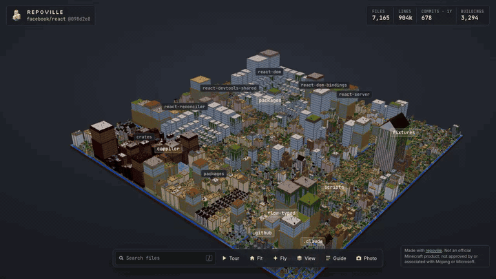
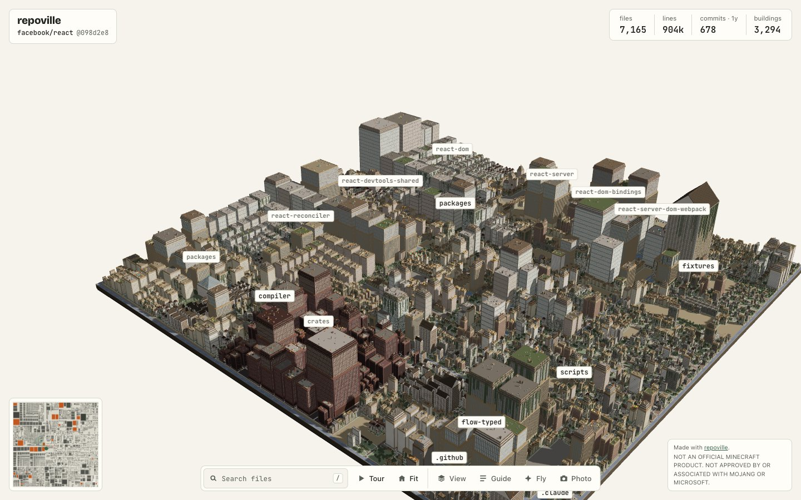
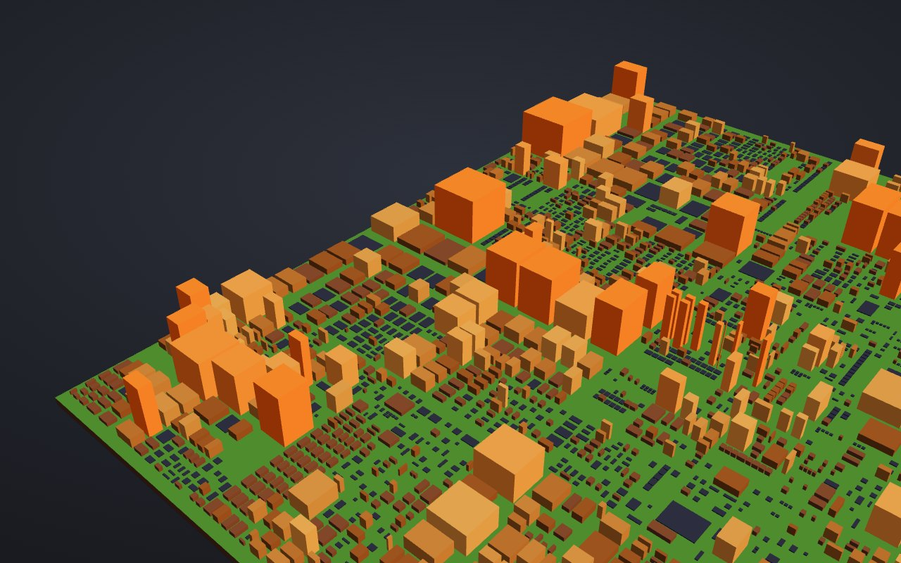
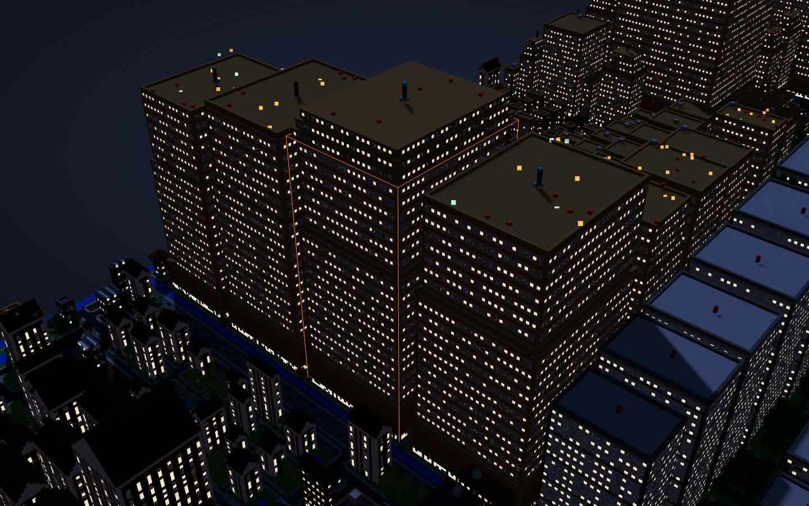
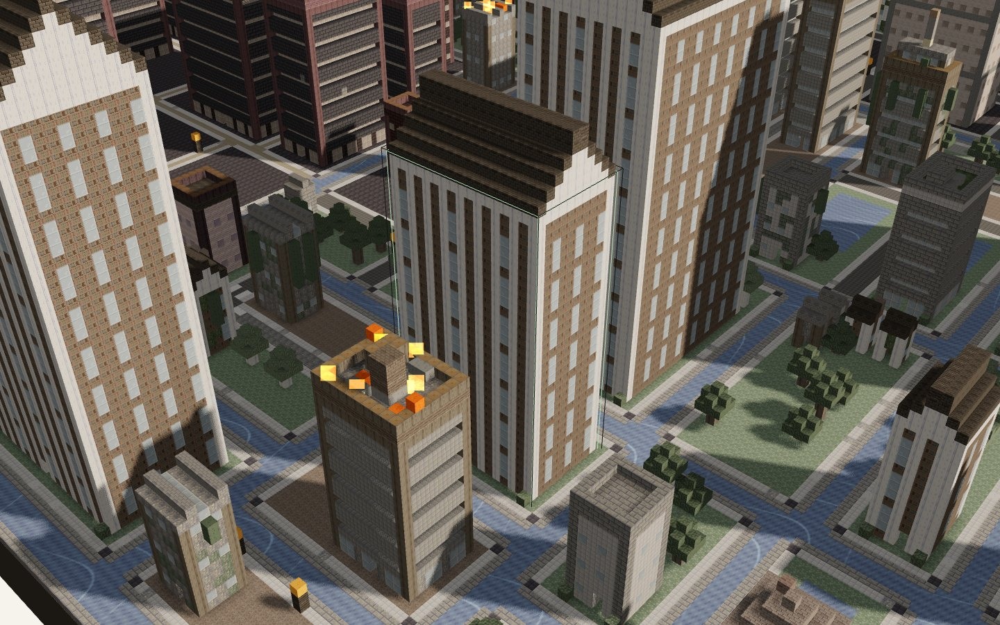
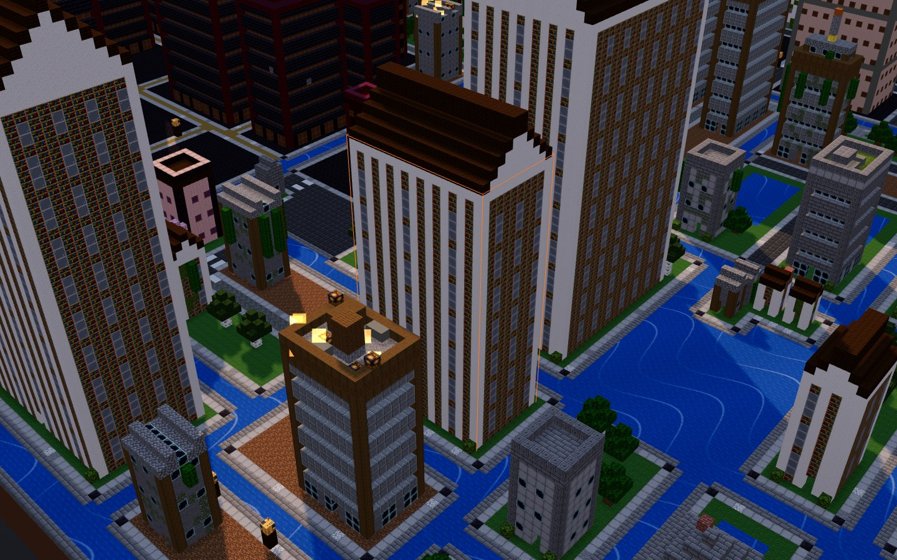

<p align="center">
  <picture>
    <source media="(prefers-color-scheme: dark)" srcset="assets/brand/wordmark-on-dark.svg">
    
  </picture>
</p>

<h3 align="center">Walk your codebase.</h3>

<p align="center">
  Repoville turns any Git repository into a city you can walk through in your browser and build in Minecraft.<br>
  Folders become districts, files become buildings, busy code burns, TODOs crumble and forgotten corners grow moss.
</p>

<p align="center">
  <a href="https://maximilianfeix.github.io/repoville/r/facebook/react/"><b>Explore React as a city →</b></a> ·
  <a href="https://maximilianfeix.github.io/repoville/">Website</a> ·
  <a href="#quick-start">Quick start</a>
</p>

<p align="center">
  <a href="https://maximilianfeix.github.io/repoville/r/facebook/react/"></a>
</p>

<p align="center"><b>No install:</b> <a href="https://maximilianfeix.github.io/repoville/r/facebook/react/">walk React in your browser</a> · <b>On your repo:</b> <a href="#quick-start">one <code>npx</code> command</a> · <b>Show it off:</b> <code>repoville badge</code></p>

> Every image here is a real recording or screenshot of the viewer. Click to open the city (one self-contained HTML file).

## What you get

- **A 3D city in one HTML file.** No Minecraft needed: orbit, fly, search, click a building for its facts, switch to a plain metric view. Pixel textures, soft shadows, ambient occlusion. Works offline and on GitHub Pages (only the web fonts need a connection).
- **Minecraft exports.** Sponge `.schem` v3 for WorldEdit and `.litematic` for Litematica, targeting Java Edition 1.21.11 by default.
- **Local and private.** Analysis runs on your machine. Nothing is uploaded, there is no telemetry, and the city file holds paths and counts, never file contents.

## The legend

| Repo | City |
|---|---|
| Folder | District with roads, a plaza and a name sign. Big folders end up downtown. |
| File | Building. Height = `min(250, 4 + round(4·√(lines/10)))` from non-blank lines. Small files are houses, big files are towers. |
| Tests | Lighthouses (white lab blocks when large) |
| Docs / Markdown | Libraries with columns and bookshelves |
| Shell / config | Workshops with sawtooth roofs |
| Commits in the last year (churn) | Top 10 % burn on the roof, top 2 % get soul fire |
| TODO / FIXME / HACK / XXX density | That share of the wall turns to cracked bricks and cobwebs |
| No commit for over a year | Moss and vines |
| Language | District theme: TS/JS plains, Rust nether, Python jungle, Go frozen peaks, Java/Kotlin badlands, C/C++ deep caves, Ruby cherry grove, Haskell/FP the end |

Fire means activity, not bad code. Moss means stable, not rotten. Exact numbers are always one click away in the viewer.

<table>
  <tr>
    <td><a href="https://maximilianfeix.github.io/repoville/r/facebook/react/"></a></td>
    <td><a href="https://maximilianfeix.github.io/repoville/r/facebook/react/?view=churn"></a></td>
  </tr>
  <tr>
    <td align="center">Viewer: search, guide, building card</td>
    <td align="center">Metric view: churn as plain columns</td>
  </tr>
</table>

### After dark

<a href="https://maximilianfeix.github.io/repoville/r/facebook/react/?time=night#f=packages/react-reconciler/src/ReactFiberWorkLoop.js"></a>

### Up close

<table>
  <tr>
    <td></td>
    <td></td>
  </tr>
  <tr>
    <td align="center">Repoville's own pixel textures (default)</td>
    <td align="center">Optional Minecraft textures, fetched by your browser at runtime (© Mojang, not bundled)</td>
  </tr>
</table>

## Quick start

Repoville needs **Node.js 22+** and **git**. One command, no install (the npm package is not published yet, so `npx` runs the release tarball):

```sh
npx --package=https://github.com/maximilianfeix/repoville/releases/latest/download/repoville.tgz repoville facebook/react --open
```

Use `.` for the current folder, `owner/repo`, or any git URL. From source instead:

```sh
git clone https://github.com/maximilianfeix/repoville && cd repoville
npm ci && npm run build
node dist/cli.js facebook/react --open
```

That writes `repoville-out/facebook-react.html` and `repoville-out/facebook-react.schem` and prints a short tour:

```
repoville: building facebook/react
  7,165 files · 903,811 LOC · 678 commits · 3,294 buildings on 1024×1024 blocks
  hottest districts (commits in 1y):
    packages/react-devtools-shared/src: 125 commits, 3 roofs on fire
  most ruined buildings (TODO/FIXME/HACK/XXX):
    packages/react-reconciler/src/ReactFiberCommitWork.js: 73 markers in 5231 lines
```

### Options

```
node dist/cli.js [build] <path|owner/repo|url>
  -o, --out <dir>          output folder (default repoville-out)
  --format <list>          html,schem,litematic,world,json (default html,schem)
  --mc <version>           target Minecraft Java version (default 1.21.11)
  --max-buildings <n>      merge folders into landmark towers above this (default 4000)
  --since <duration>       churn window: 30d, 6m, 1y (default 1y)
  --include / --exclude    glob filters, repeatable
  --seed <n>               decoration seed
  --ref <commit>           render a specific commit of a remote repo
node dist/cli.js badge [owner/repo]   print the README badge
MC_RCON_PW=… node dist/cli.js live <repo> --rcon localhost:25575 --world-dir /srv/mc/world --at 0,-60,0
```

A `repoville.config.json` in a local repo can set `format`, `mc`, `maxBuildings`, `since`, `include`, `exclude`, `ignore`, `seed`, `textured` and `palette` overrides (output folder, `--open` and `--gallery` stay command-line only). Config files inside cloned remote repos are ignored.

## Minecraft

| Output | Status |
|---|---|
| `.schem` (Sponge v3) | Pasted with WorldEdit 7.3.19 on Paper 1.21.11 and block-checked over RCON (`test/e2e/worldedit-paste.ts`) |
| `.litematic` (v6) | Round-trip checked with litemapy 0.11 in the test suite |
| World `.zip` (superflat, Java 1.21.x) | Loaded as the server world on Paper 1.21.11 and block-checked (`test/e2e/world-load.ts`) |
| Live building over RCON | Built on Paper 1.21.11 with structure tiles + `/place template`, block-checked (`test/e2e/live.ts`) |

Paste a schematic: copy it to `plugins/WorldEdit/schematics/`, then `//schem load <name>` and `//paste`. Or unzip `*-world.zip` into your `saves/` folder: a creative superflat world with the city at spawn (ground at y = −61, daylight fixed, no mobs). Buildings reach up to about 290 blocks.

## How big can a repo be?

The city footprint is capped at 1024×1024 blocks. Above `--max-buildings` (default 4000), the deepest folders are merged into single landmark towers. Measured on an Apple Silicon Mac (viewer fps in headless Chromium at 1280×720):

| Repo | Files | Render (warm clone) | city.html | Viewer |
|---|---|---|---|---|
| facebook/react | 7,165 | ~2 s | 1.9 MB | 60 fps without shadows |
| torvalds/linux | 95,948 | ~25 s | 2.0 MB | 57 fps without shadows |

Remote repos are cloned blobless and only as far back as the history window needs (Linux: 731 MB, about 4.5 minutes cold).

## FAQ

**Do I need Minecraft?** No. The HTML viewer is the main output.<br>
**Does it upload my code?** No. Everything runs locally; the HTML file contains file paths and counts only.<br>
**Private repos?** Point it at your local checkout.<br>
**Is it the same every time?** Yes, for the same files, git history and options: randomness is seeded and ages are measured from the HEAD commit, not today. Uncommitted or untracked files are included, so a dirty working tree renders differently from a clean checkout.

## Roadmap

- npm release (`npx repoville`)
- v2: coding agents walking the city as villagers while they work

## Contributing

Issues and PRs are welcome. `npm test` runs the unit, property and golden tests; `docs/DECISIONS.md` explains why things are the way they are.

---

<sub>MIT licensed. NOT AN OFFICIAL MINECRAFT PRODUCT. NOT APPROVED BY OR ASSOCIATED WITH MOJANG OR MICROSOFT.</sub>
