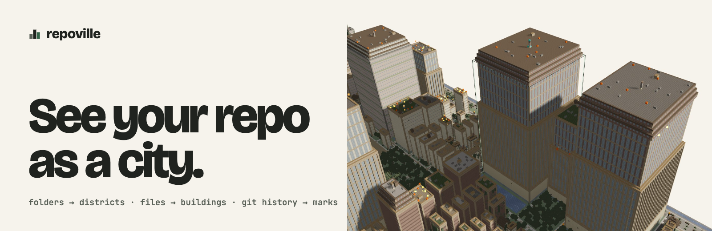

<picture>
  <source media="(prefers-color-scheme: dark)" srcset="docs/media/banner-dark.png">
  
</picture>

<p>
  <a href="https://github.com/maximilianfeix/repoville/releases/latest"></a>
  <a href="LICENSE"></a>
  <a href="#faq"></a>
  <a href="#minecraft"></a>
</p>

[Website](https://maximilianfeix.github.io/repoville/) · [Demo](https://maximilianfeix.github.io/repoville/r/facebook/react/) · [Quick start](#quick-start) · [How to read it](#the-legend) · [Exports](#minecraft) · [Options](#options) · [FAQ](#faq)

---

repoville reads a Git repository and builds it as a city. Every folder is a district, every file a building as tall as its line count, and the last year of commits shows up on the roofs: the busiest files burn, files nobody touched grow moss, TODO comments crack the walls. You get one HTML file you can open, send or host, and the same city as Minecraft blocks if you want to walk it for real.

<a href="https://maximilianfeix.github.io/repoville/r/facebook/react/#f=packages%2Freact-dom-bindings%2Fsrc%2Fclient%2FReactFiberConfigDOM.js"></a>

<sub>facebook/react, with <code>packages/react-dom-bindings/src/client/ReactFiberConfigDOM.js</code> selected: 6,581 lines, 42 commits in the last year. Click to open this exact view.</sub>

- **One HTML file.** A 3D viewer with search, building cards, a churn view, history, night mode and photo export. Opens offline; only the web fonts need a connection.
- **Runs on your machine.** Files and git history are read locally, nothing is uploaded, no telemetry. The city file holds paths and counts, never file contents.
- **Signals from git.** Height from non-blank lines, fire from commits in the last year, moss after a year without one, cracks from TODO/FIXME/HACK/XXX.
- **Actual blocks.** `.schem` for WorldEdit, `.litematic` for Litematica, a world folder, or a live build over RCON. Checked on Paper 1.21.11 with WorldEdit 7.3.19.

## Quick start

Repoville needs **Node.js 22+** and **git**. One command, no install (the npm package is not published yet, so `npx` runs the release tarball):

```sh
npx --package=https://github.com/maximilianfeix/repoville/releases/latest/download/repoville.tgz repoville facebook/react --open
```

Use `.` for the current folder, `owner/repo`, or any git URL. From source instead:

```sh
git clone https://github.com/maximilianfeix/repoville && cd repoville
npm ci && npm run build
node dist/cli.js facebook/react --open
```

That writes `repoville-out/facebook-react.html` and `repoville-out/facebook-react.schem` and prints a short tour:

```
repoville: building facebook/react
  7,165 files · 903,811 LOC · 678 commits · 3,294 buildings on 1024×1024 blocks
  hottest districts (commits in 1y):
    packages/react-devtools-shared/src: 125 commits, 3 roofs on fire
  most ruined buildings (TODO/FIXME/HACK/XXX):
    packages/react-reconciler/src/ReactFiberCommitWork.js: 73 markers in 5231 lines
```

### Options

```
node dist/cli.js [build] <path|owner/repo|url>
  -o, --out <dir>          output folder (default repoville-out)
  --format <list>          html,schem,litematic,world,json (default html,schem)
  --mc <version>           target Minecraft Java version (default 1.21.11)
  --max-buildings <n>      merge folders into landmark towers above this (default 4000)
  --since <duration>       churn window: 30d, 6m, 1y (default 1y)
  --include / --exclude    glob filters, repeatable
  --seed <n>               decoration seed
  --ref <commit>           render a specific commit of a remote repo
  --timelapse              add a History view: the city growing over the git history
  --diff <ref>             add a Diff view: buildings added/changed since the merge base with <ref>
node dist/cli.js badge [owner/repo]   print the README badge
MC_RCON_PW=… node dist/cli.js live <repo> --rcon localhost:25575 --world-dir /srv/mc/world --at 0,-60,0
```

A `repoville.config.json` in a local repo can set `format`, `mc`, `maxBuildings`, `since`, `include`, `exclude`, `ignore`, `seed`, `textured` and `palette` overrides (output folder, `--open` and `--gallery` stay command-line only). Config files inside cloned remote repos are ignored.


## The legend

| Repo | City |
|---|---|
| Folder | District with roads, a plaza and a name sign. Big folders end up downtown. |
| File | Building. Height = `min(250, 4 + round(4·√(lines/10)))` from non-blank lines. Small files are houses, big files are towers. |
| Tests | Lighthouses (white lab blocks when large) |
| Docs / Markdown | Libraries with columns and bookshelves |
| Shell / config | Workshops with sawtooth roofs |
| Commits in the last year (churn) | Top 10 % burn on the roof, top 2 % get soul fire |
| TODO / FIXME / HACK / XXX density | That share of the wall turns to cracked bricks and cobwebs |
| No commit for over a year | Moss and vines |
| Language | District theme: TS/JS plains, Rust nether, Python jungle, Go frozen peaks, Java/Kotlin badlands, C/C++ deep caves, Ruby cherry grove, Haskell/FP the end, Swift/Lua copper town, C#/PHP reef |

All nine building families, each with a real render: [docs/BUILDINGS.md](docs/BUILDINGS.md).

Fire means activity, not bad code. Moss means stable, not rotten. Exact numbers are always one click away in the viewer.

<table>
  <tr>
    <td><a href="https://maximilianfeix.github.io/repoville/r/facebook/react/"></a></td>
    <td><a href="https://maximilianfeix.github.io/repoville/r/facebook/react/?view=churn"></a></td>
  </tr>
  <tr>
    <td align="center">Viewer: search, guide, building card</td>
    <td align="center">Metric view: churn as plain columns</td>
  </tr>
</table>

### History

`--timelapse` adds a **History** view to the viewer: buildings rise as files appear and grow with their line counts, frame by frame across the git history ([try it on this repo](https://maximilianfeix.github.io/repoville/r/maximilianfeix/repoville/?view=history)). It reads line deltas with one `git log --numstat`; on a blobless remote clone the first run downloads the file history (ripgrep: about 3.5 minutes once, then about 1 s).

### After dark

<a href="https://maximilianfeix.github.io/repoville/r/facebook/react/?time=night#f=packages/react-reconciler/src/ReactFiberWorkLoop.js"></a>

### Up close

<table>
  <tr>
    <td></td>
    <td></td>
  </tr>
  <tr>
    <td align="center">Repoville's own pixel textures (default)</td>
    <td align="center">Optional Minecraft textures, fetched by your browser at runtime (© Mojang, not bundled)</td>
  </tr>
</table>

## Demos

Each demo is the HTML file repoville wrote, unchanged.

| Repository | Language | Size | Views |
|---|---|---|---|
| [facebook/react](https://maximilianfeix.github.io/repoville/r/facebook/react/) | JavaScript | 7,165 files, 903,811 lines | [night](https://maximilianfeix.github.io/repoville/r/facebook/react/?time=night) · [churn](https://maximilianfeix.github.io/repoville/r/facebook/react/?view=churn) |
| [torvalds/linux](https://maximilianfeix.github.io/repoville/r/torvalds/linux/) | C | 95,858 files, 33,779,818 lines | [night](https://maximilianfeix.github.io/repoville/r/torvalds/linux/?time=night) · [churn](https://maximilianfeix.github.io/repoville/r/torvalds/linux/?view=churn) |
| [BurntSushi/ripgrep](https://maximilianfeix.github.io/repoville/r/BurntSushi/ripgrep/) | Rust | 227 files, 68,267 lines | [night](https://maximilianfeix.github.io/repoville/r/BurntSushi/ripgrep/?time=night) · [churn](https://maximilianfeix.github.io/repoville/r/BurntSushi/ripgrep/?view=churn) |
| [junegunn/fzf](https://maximilianfeix.github.io/repoville/r/junegunn/fzf/) | Go | 161 files, 53,292 lines | [night](https://maximilianfeix.github.io/repoville/r/junegunn/fzf/?time=night) · [churn](https://maximilianfeix.github.io/repoville/r/junegunn/fzf/?view=churn) |
| [pallets/flask](https://maximilianfeix.github.io/repoville/r/pallets/flask/) | Python | 230 files, 26,369 lines | [night](https://maximilianfeix.github.io/repoville/r/pallets/flask/?time=night) · [churn](https://maximilianfeix.github.io/repoville/r/pallets/flask/?view=churn) |
| [maximilianfeix/repoville](https://maximilianfeix.github.io/repoville/r/maximilianfeix/repoville/) | TypeScript | 135 files, 10,780 lines | [night](https://maximilianfeix.github.io/repoville/r/maximilianfeix/repoville/?time=night) · [churn](https://maximilianfeix.github.io/repoville/r/maximilianfeix/repoville/?view=churn) |

## Publish your repo's city (GitHub Action)

Add this workflow and your repo gets its own city at `https://<owner>.github.io/<repo>/`, rebuilt on every push. The action renders with the latest Repoville release; enable Pages with source "GitHub Actions" first.

```yaml
# .github/workflows/repoville.yml
name: repoville
on:
  push: { branches: [main] }
  workflow_dispatch:
permissions:
  contents: read
  pages: write
  id-token: write
jobs:
  city:
    runs-on: ubuntu-latest
    environment:
      name: github-pages
      url: ${{ steps.deploy.outputs.page_url }}
    steps:
      - uses: actions/checkout@v4
        with: { fetch-depth: 0 }   # churn and age need history
      - uses: maximilianfeix/repoville@v0
      - uses: actions/upload-pages-artifact@v3
        with: { path: repoville-city }
      - id: deploy
        uses: actions/deploy-pages@v4
```

For pull requests, `with: { diff: origin/${{ github.base_ref }} }` adds a **Diff** view that highlights new and changed buildings (needs `fetch-depth: 0`); `timelapse: true` adds the History view.

The job summary prints a badge that links to your city. Inputs: `path`, `since`, `max-buildings`, `formats` (add `schem,litematic,world` to publish Minecraft files next to the viewer) and `version`. The render script (`action/render.sh`) is tested locally; the action has not run on GitHub-hosted runners yet.

## Minecraft

| Output | Status |
|---|---|
| `.schem` (Sponge v3) | Pasted with WorldEdit 7.3.19 on Paper 1.21.11 and block-checked over RCON (`test/e2e/worldedit-paste.ts`) |
| `.litematic` (v6) | Round-trip checked with litemapy 0.11 in the test suite |
| World `.zip` (superflat, Java 1.21.x) | Loaded as the server world on Paper 1.21.11 and block-checked (`test/e2e/world-load.ts`) |
| Live building over RCON | Built on Paper 1.21.11 with structure tiles + `/place template`, block-checked (`test/e2e/live.ts`) |

Paste a schematic: copy it to `plugins/WorldEdit/schematics/`, then `//schem load <name>` and `//paste`. Or unzip `*-world.zip` into your `saves/` folder: a creative superflat world with the city at spawn (ground at y = −61, daylight fixed, no mobs). Buildings reach up to about 290 blocks.

## How big can a repo be?

The city footprint is capped at 1024×1024 blocks. Above `--max-buildings` (default 4000), the deepest folders are merged into single landmark towers. Measured on an Apple Silicon Mac (viewer fps in headless Chromium at 1280×720):

| Repo | Files | Render (warm clone) | city.html | Viewer |
|---|---|---|---|---|
| facebook/react | 7,165 | ~2 s | 1.9 MB | 60 fps without shadows |
| torvalds/linux | 95,948 | ~25 s | 2.0 MB | 57 fps without shadows |

Remote repos are cloned blobless and only as far back as the history window needs (Linux: 731 MB, about 4.5 minutes cold).

## FAQ

**Do I need Minecraft?** No. The HTML viewer is the main output.<br>
**Does it upload my code?** No. Everything runs locally; the HTML file contains file paths and counts only.<br>
**Private repos?** Point it at your local checkout.<br>
**Is it the same every time?** Yes, for the same files, git history and options: randomness is seeded and ages are measured from the HEAD commit, not today. Uncommitted or untracked files are included, so a dirty working tree renders differently from a clean checkout.

## Roadmap

- npm release (`npx repoville`)
- v2: coding agents walking the city as villagers while they work

## Contributing

Issues and PRs are welcome. `npm test` runs the unit, property and golden tests; `docs/DECISIONS.md` explains why things are the way they are.

---

<sub>MIT licensed. NOT AN OFFICIAL MINECRAFT PRODUCT. NOT APPROVED BY OR ASSOCIATED WITH MOJANG OR MICROSOFT.</sub>
