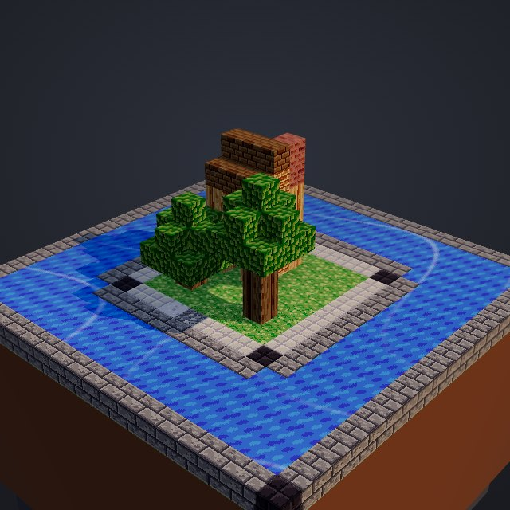
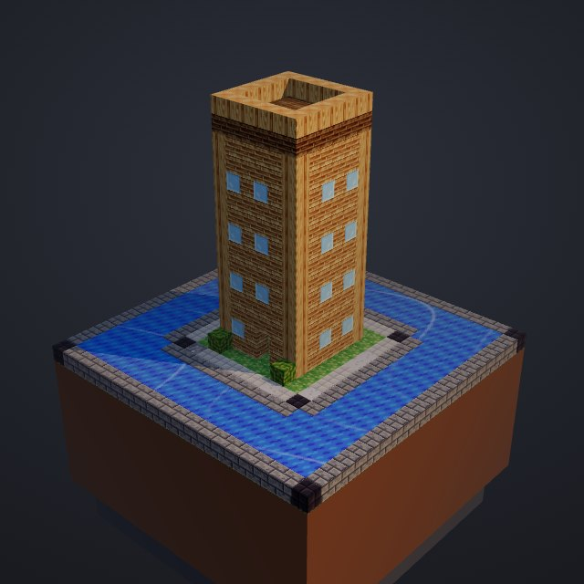
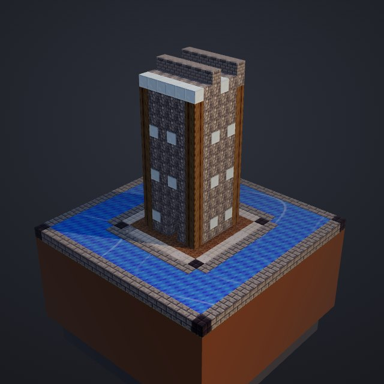
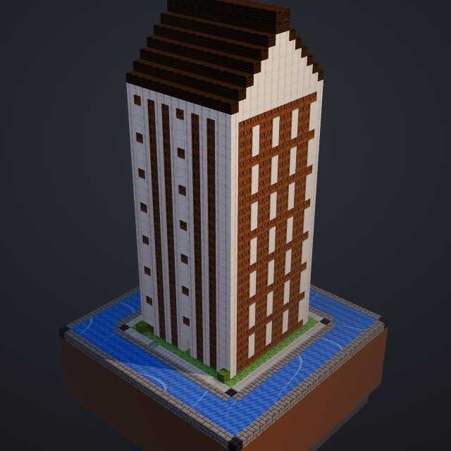
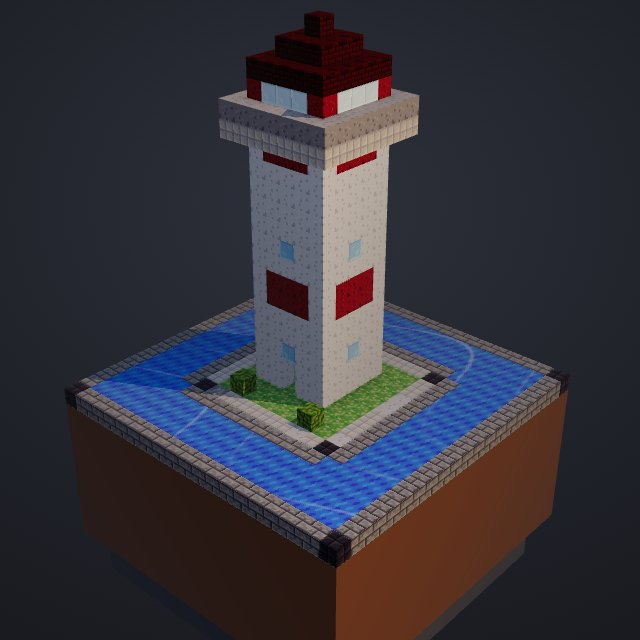
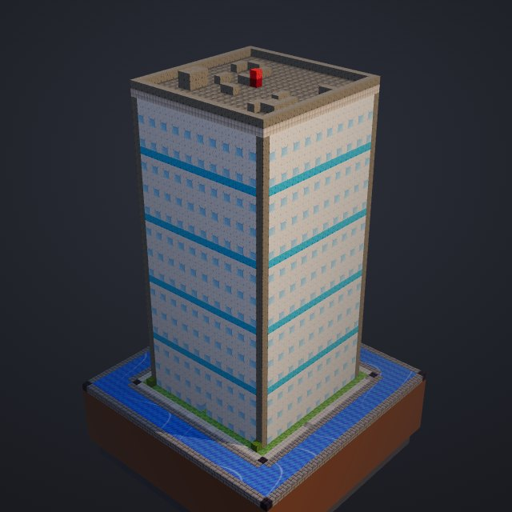
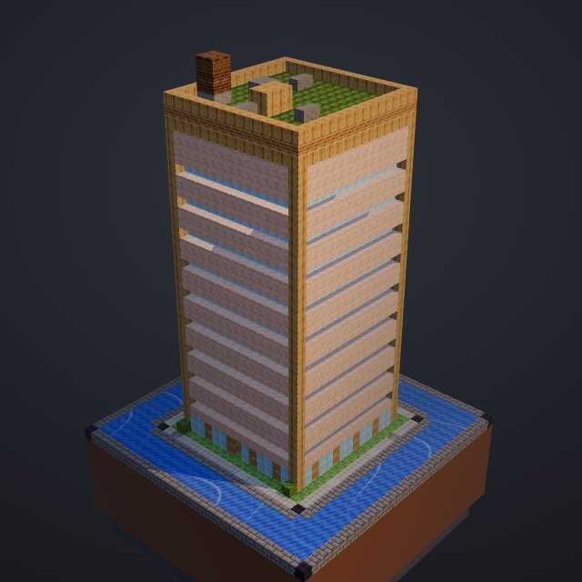
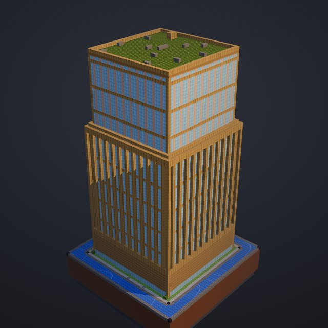
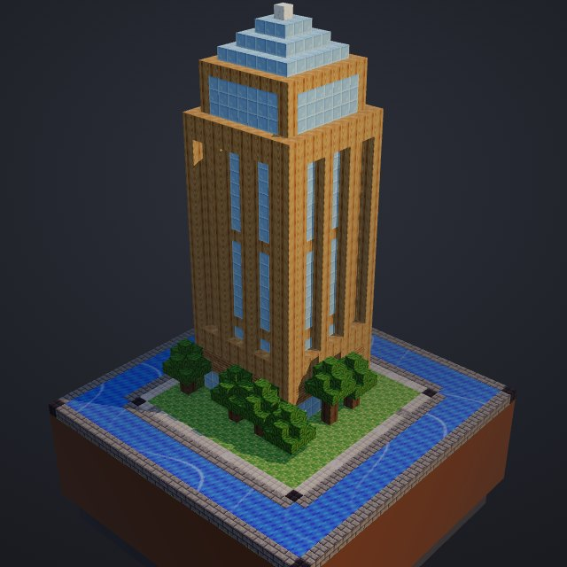

# Building families

Every file becomes one building. Its **height is always the metric**: `4 + 4·√(lines/10)` blocks, capped at 250. What changes between files is the *family*, which is picked from plain file facts in `chooseStyle` (`src/build/building.ts`). The colours come from the language theme (TS/JS plains here), so the same family looks different in a Rust or Go district.

Each picture below is a real render: a repository with a single file, opened in the viewer.

| | |
|---|---|
|  | **House** · files under ~9 lines. Small houses on a shared lawn, packed into a grid with the other tiny files of their folder. |
|  | **Townhouse** · up to ~60 lines (height ≤ 14). A narrow block with punched windows. A folder made mostly of them is laid out as terraces along lanes. |
|  | **Workshop** · small shell scripts and config files (height ≤ 14). Rough stone walls: the tooling of the repo. |
|  | **Library** · documentation (Markdown, files under `docs/`). Bookshelf walls under a pitched roof. |
|  | **Lighthouse** · small test files (height ≤ 16). White with red bands and a lamp on top, standing guard next to the code. |
|  | **Test lab** · larger test files. A calm white block with an accent stripe and a red beacon on the roof. |
|  | **Midrise** · up to ~1,200 lines (height ≤ 48). Recessed ribbon windows, one glass row per floor, and a flat roof with HVAC units. |
|  | **Tower** · larger files. A podium, a shaft with piers and glass strips (on wide footprints), a setback and a cornice. |
|  | **Landmark** · a whole folder merged into one tower when the city has more buildings than `--max-buildings` (default 4,000). A glass pyramid crown marks it; its card lists the files inside. |

The largest file of each folder with at least three buildings also gets a **gold crown** (stepped tiers above the roof). It sits above the metric height, so it never reads as extra lines.

Overlays sit on top of any family: **fire** on the roof for the most-changed files of the last year, **moss and vines** for files untouched for a year, **cracks** for TODO/FIXME/HACK comments.

How these images were made: one repository per family (for example a single 3,000-line `core.ts` for the tower, or 60 files in one folder with `--max-buildings 5` for the landmark), each rendered with `repoville <repo> --format html` and photographed in the viewer's home view.
