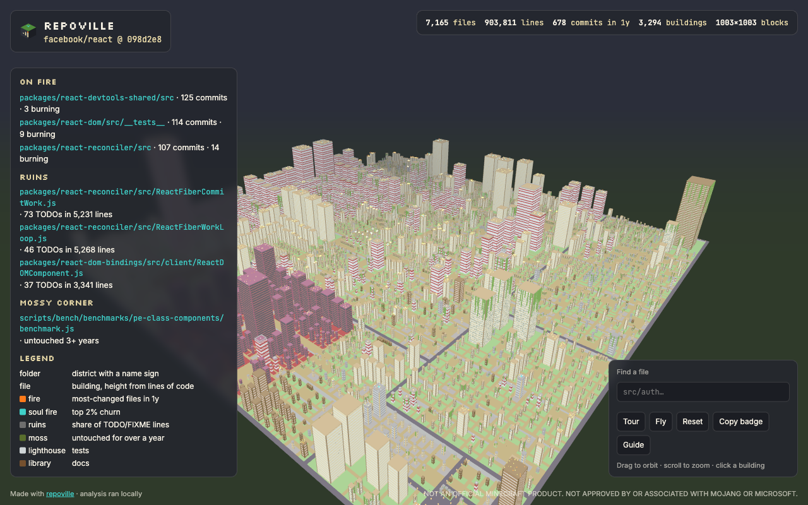
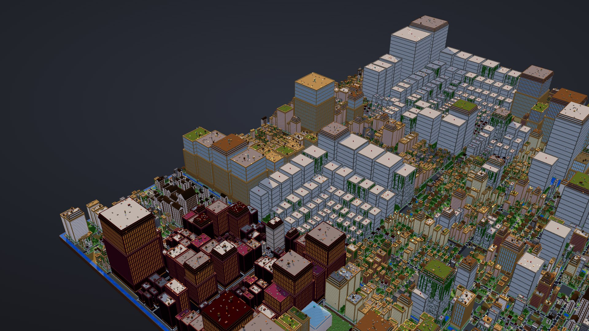
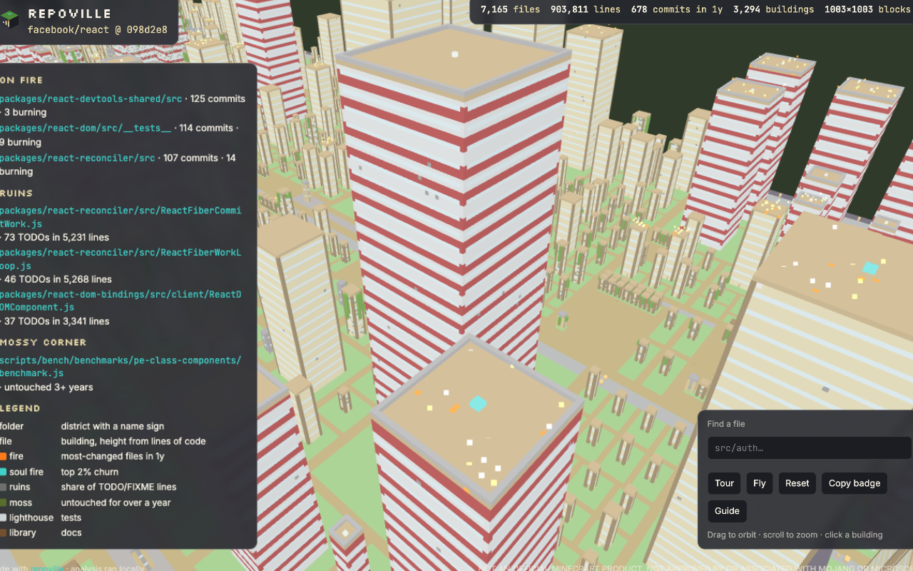
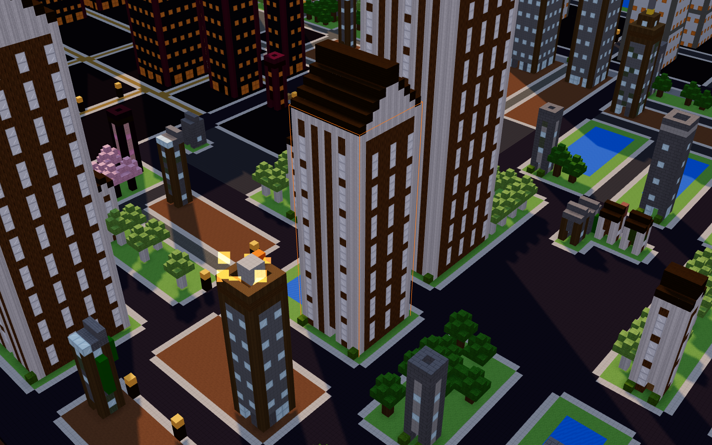

# Visual audit (2026-10-15 → 2026-10-16)

What the city and its surfaces looked like before the overhaul, what was wrong, and what changed. All images are real renders of `facebook/react` (and `BurntSushi/ripgrep` for close-ups).

| Before | After |
|---|---|
|  |  |
|  |  |

## Problems found (severity)

| # | Problem | Severity | Fix | PR |
|---|---|---|---|---|
| 1 | Every building was the same box; height/side ≈ 2.5 at every size, so the city read as a carpet | critical | nine building families with roofs, setbacks, crowns; class massing | #1, #25 |
| 2 | Big files clustered in the same corner of every district; no downtown | high | top-down mirroring toward the parent centre | #2 |
| 3 | 1–2 block grass rings around every building | high | street-edge footprints, pocket parks and ponds | #2 |
| 4 | Flat unlit colours, no depth | high | lights, static soft shadows, ACES, baked AO, diorama base | #1, #2, #9 |
| 5 | No orientation: districts indistinguishable | high | district labels, neighbourhood facades, canals between top-level districts, gold crowns on the largest file | #1, #10, #19 |
| 6 | HUD panels covered a third of the city | high | dock + collapsible guide drawer + building card | #1 |
| 7 | Hundreds of identical red-white "needle" test towers | medium | lighthouses only for small tests, calm lab blocks for large ones | #1 |
| 8 | Linux: hundreds of folder towers stuck at the 250 cap | medium | landmark volume sizing (footprint² × height ∝ LOC) | #1 |
| 9 | Untextured surfaces looked like plastic up close | medium | procedural 16×16 pixel textures; optional runtime Minecraft textures | #12 |
| 10 | Logo read as a grass block, wordmark "v" read as "u" | medium | stepped-tower mark generated from isometric geometry, fixed lettering | #20 |
| 11 | Landing page: mobile hero lost the city, leaky CSS, overused pixel font, weak contrast | medium | design pass after independent critique | #20 |

## Measurements

| | Before | After |
|---|---|---|
| React quads | 0.88 M | 3.0–3.3 M (more geometry: roofs, windows, trees) |
| React fps (headless, no shadows) | 60 | 60 (shadows auto-off below 45 fps) |
| React city.html | 1.3 MB | 1.9 MB |
| Linux city.html | 2.4 MB | 3.3 MB (incl. merged-file search index) |

## Still open

- Shader-drawn facade windows to cut quads on window-heavy cities.
- Suburb houses arranged as rows along lanes.
- A dedicated portrait composition for the mobile hero.
